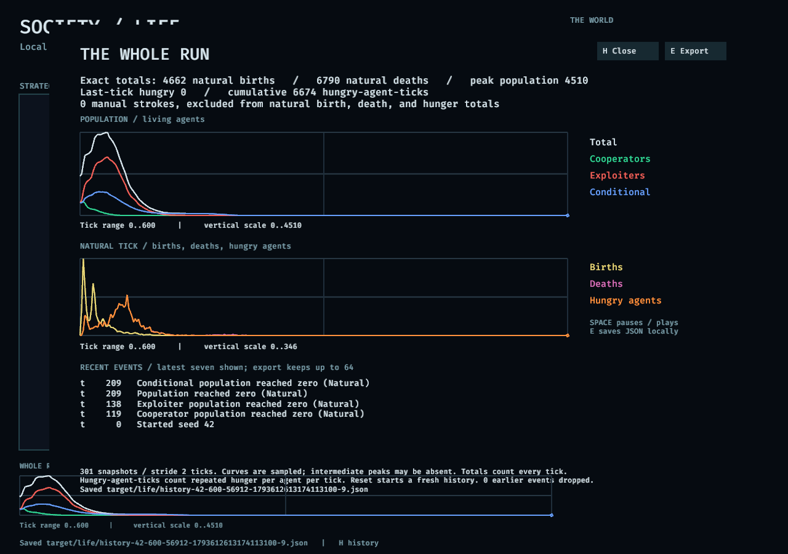

# Live society: checks and experiments

Measured on November 2, 2026, on an NVIDIA GeForce RTX 3090 using Vulkan. The rules are a toy model; these runs establish behavior of this implementation, not conclusions about human societies.

## Spatial behavior

Three seeds (42, 43, 44), 96 by 64 cells, 500 ticks each. The first experiment used the original starting probabilities: 40% cooperators, 30% exploiters, 30% conditional agents, within a population occupying approximately 35% of the grid. No painting or rule changes occurred during these runs.

| Seed | Initial population | Population at 500 | Births | Deaths | Matching strategies among occupied neighbor pairs: start / end |
| --- | ---: | ---: | ---: | ---: | ---: |
| 42 | 2,128 | 1,117 | 18,361 | 19,372 | 33.5% / 88.9% |
| 43 | 2,035 | 1,164 | 12,510 | 13,381 | 35.3% / 89.7% |
| 44 | 2,073 | 1,841 | 24,737 | 24,969 | 34.6% / 83.5% |

The populations still had births and deaths on tick 500. All three strategies remained present. Matching neighbor pairs count the eight directions on the wrapping grid once per undirected pair, excluding vacant cells. Clustering is an observation of the spatial rules, not evidence of planning or intelligence. Inheritance itself promotes nearby matching strategies.

In the same three seeds, setting cooperation to zero or food regrowth to zero resulted in extinction by tick 500. The baseline regrows only two food units per cell, while agents consume three energy units per tick (four when exploiting with exploitation enabled). Cooperation produces extra energy. Dependence on that production under scarcity is a modeling assumption, not a discovered moral lesson.

The full summary is [spatial-summary.json](spatial-summary.json). These headless baseline runs measured 2,189–2,286 ticks per second, including GPU dispatch, readback and host audits, excluding GPU initialization and JSON output. This is a small grid throughput measurement; it is not the native window's frame rate or a general hardware benchmark.

## Checking a possible green advantage

The initial display tinted empty food-rich cells green. This could make empty space look like cooperative territory. Strategy view now uses neutral empty cells. Blue identifies a conditional strategy, which can choose either cooperation or exploitation on a given tick; color does not directly identify the action.

The default starting mix is now approximately equal: probabilities 33% cooperator, 33% exploiter, 34% conditional. Actual seeded counts fluctuate. With that same mix, seeds 42–44 were run for 500 ticks under four conditions:

| Condition | Final green share | Final red share | Final blue share | Final population |
| --- | ---: | ---: | ---: | ---: |
| Scarcity: regrowth 2 | 4.3–21.2% | 17.8–25.1% | 60.9–70.6% | 1,310–1,912 |
| Abundance: regrowth 6 | 0–0.05% | 62.5–65.1% | 34.9–37.5% | 5,973–5,990 |
| Abundance, cooperation 0 | 0–0.07% | 63.3–65.4% | 34.6–36.7% | 5,877–5,903 |
| Scarcity, exploitation 0 | 18.2–29.2% | 23.3–25.3% | 47.5–56.5% | 4,103–4,380 |

These are ranges across three seeds, not confidence intervals. Green does not always win. The outcomes depend on production, theft, metabolism, local access to food and conditional behavior. Three seeds and one horizon do not establish a general ranking of strategies.

See [balance-summary.json](balance-summary.json) for exact initial and final counts and totals. Reproduce the two main conditions:

```powershell
cargo build --features viewer -j 4
.\target\debug\bad_econ.exe life-run --scenario docs/experiments/life/scarcity.json --days 500 --output target/life/scarcity.json
.\target\debug\bad_econ.exe life-run --scenario docs/experiments/life/abundance.json --days 500 --output target/life/abundance.json
```

Change only `seed` to 43 or 44 for the other replicates. The remaining conditions also set `rules.cooperation` or `rules.exploitation` to zero. Both scenario files contain all starting parameters.

## Verification

The [GPU test log](gpu-tests.log) records 15 passing tests: five spatial tests, six older society tests and four industrial GPU regressions. Spatial tests cover toroidal locality, exact theft transfers, contested births with one resource-funded winner, starvation and aging, rejection of invalid controls, distinct identities and lineage, mutation, and identical results across GPU workgroups 32 and 64.

All simulation execution used the GPU. `cargo clippy --all-targets --features viewer -j 4 -- -D warnings`, formatting and whitespace checks passed. After the history changes and balanced starting mix, the five spatial tests passed again; see [the updated GPU log](history-gpu-tests.log).

The native viewer's `life-check` exercised shared-GPU initialization, pause, one tick, live rule changes, painting, reset, resumed playback, export and screenshot capture. It then ran 600 ticks at the fast playback setting. The history retained 301 samples at stride 2 while preserving ticks 0 and 600. Exact totals reconciled with the final population. Painting did not change natural totals, and resetting cleared history. See [the native check log](native-check.log) and [verification record](verification.json).

The automated check deliberately changes regrowth to 3 before resetting, so its screenshots show a different condition from the default regrowth of 2. This seed-42 run peaked at 4,510 agents and became extinct at tick 209. At tick 600, history still retained the rise and decline, with 4,662 births, 6,790 deaths and 6,674 hungry-agent-ticks. The first population was 2,128, so `2128 + 4662 = 0 + 6790`. The full exported record is [history-example.json.gz](history-example.json.gz).



The [map screenshot](ui.png) shows neutral empty cells and the compact whole-run timeline. Screenshots are captures from Bevy, converted losslessly from PPM to PNG.

A separate interactive playtest used the actual mouse and keyboard to pause, switch food/strategy layers, paint exploiters inside a conditional colony, resume and change food regrowth. In that exploratory seed-53 session, regrowth was stopped at tick 3778 with population 2,017; population was zero by the observation at tick 4962. That intervention was not a paired experiment. It exposed the old chart's loss of earlier events and the misleading green tint of empty terrain.

The research connection is [Federico, Balakrishna and Janssen (2025)](https://doi.org/10.1371/journal.pcsy.0000040). Our ecological life cycle and inherited strategies differ from that paper. The Learn panel treats it as a question to explore, not a replication.
