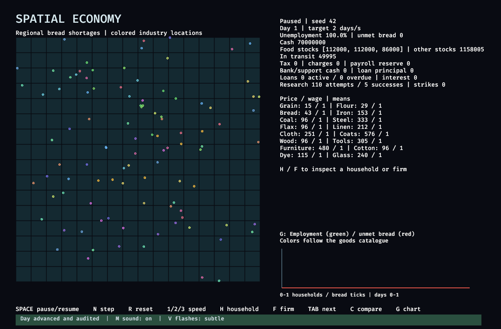

# Evidence for the smaller Windows viewer PR stack

Code changes are split into build support, mechanical module extraction, performance, and feedback. This evidence branch is separate from the code PRs so reports and captures do not inflate their diffs. Commit identities and the full measurements are in [summary.json](summary.json).

## Standalone performance layer

Windows 11 Pro 10.0.26200; Ryzen 9 9950X3D; RTX 3090 24 GiB; NVIDIA 616.56; Vulkan; Rust 1.97.1 development profile. The baseline is the original runtime with the audited ICU build overrides.

The intended protocol opens the viewer with 100,000 households, paused at day zero, waits five seconds, then records three 20-second process CPU samples. No other test or compilation ran during the samples. Desktop input/focus was not instrumented; these are interactive-desktop observations with substantial variation.

| CPU-seconds per approximately 20 seconds | Before | Standalone performance layer |
| --- | ---: | ---: |
| Sample 1 | 21.468750 | 1.359375 |
| Sample 2 | 6.703125 | 8.234375 |
| Sample 3 | 12.000000 | 0.062500 |
| Median | 12.000000 | 1.359375 |

Median reduction: **88.671875%**. This is a new measurement of the standalone performance commit, separate from the earlier combined-build result of 98.4375%. Raw counter samples, wall times, and binary hashes are in [before-profile.json](before-profile.json) and [performance-profile.json](performance-profile.json). The result is limited to viewer CPU usage on this machine.

Warmed headless runs at 1,000 and 10,000 households produced matching scenario hashes, final state hashes, and readback counts after 40 days. Before/after median day times were 31.925 / 39.481 ms at 1,000 households and 57.607 / 58.478 ms at 10,000. These runs did not demonstrate a headless speedup. See the [full before report](before-warmed-headless.json.gz), [full performance-layer report](performance-headless.json.gz), and [hash summary](headless-summary.json).

## Validation

- Performance layer: build, Clippy with all targets and `-D warnings`, four GPU tests, and GPU viewer verification passed.
- Feedback layer: build, Clippy, and four GPU tests passed. GPU viewer verification passed reset/step/comparison cues, audited day, inspections, and all charts on an unchanged retry.
- Module extraction: moved bodies matched the original after visibility/name/whitespace normalization; build and GPU viewer verification passed on an unchanged retry.
- The first module and feedback viewer attempts failed during Vulkan surface configuration with `Failed to wait for GPU to come idle`. Both initial failure logs and retry logs are retained here. This intermittent startup failure remains unresolved.
- Manual preference-key and human listening checks were not completed. The automated feedback run includes the audio plugin and embedded WAV assets.

Logs are named `stack-<layer>-<check>.txt`. Captures are real GPU viewer frames, converted losslessly from PPM to PNG.

[Feedback overview](feedback-overview.png)

Reproduce CPU measurements with `scripts/measure-windows-viewer.ps1`. Run GPU checks with `cargo test --locked --features viewer --test gpu -- --test-threads=1` and `cargo run --locked --features viewer -- view-check --households 10000`.
